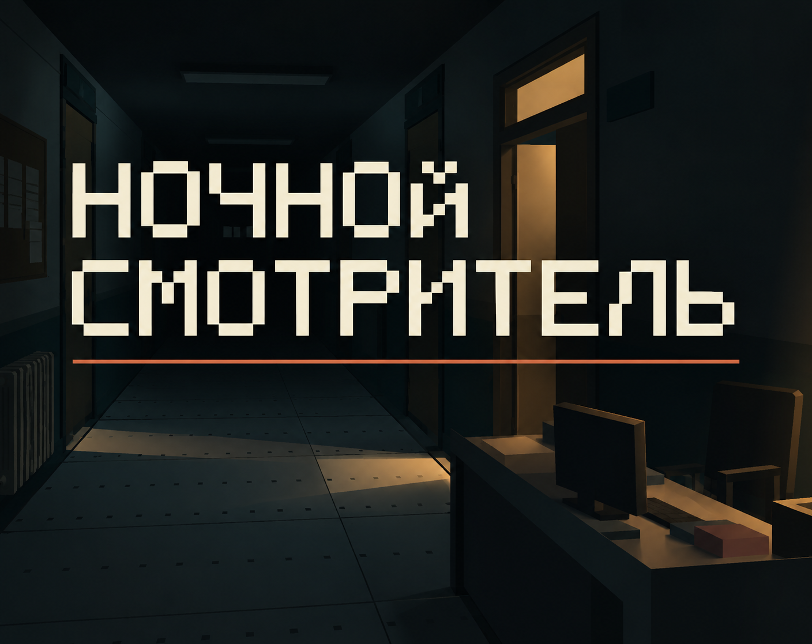

# Night Caretaker · Ночной смотритель

*AI-assisted cover illustration, not a gameplay screenshot. / Обложка с использованием ИИ, не игровой скриншот.*

Take the night shift: explore the building, listen and respond to its events.

Заступите на ночную смену: исследуйте здание, слушайте и реагируйте на события.

[Play / Играть](https://ansns.itch.io/night-caretaker-godot-playtest) · [English](#english) · [Русский](#русский)

## Editions / Редакции

- [Godot](editions/godot/): current reviewed source snapshot; playable version linked above.
- [Classic](editions/classic/): historical C edition; not included in this initial source snapshot.
- [2D](editions/2d/): unreleased candidate; status only, no public build or source here yet.

Один репозиторий для одной игры. Здесь сейчас опубликован только проверенный исходный срез Godot, не все исторические и экспериментальные версии.

## English

### About

A Godot 4.6.3 game for desktop and modern desktop browsers. This source snapshot corresponds to version 06.

### Run from source

1. Install Godot 4.6.3 (standard edition).
2. Import `editions/godot/project.godot` into the editor.
3. Wait for asset import, then press F6 on `scenes/main.tscn` or F5 to run the project.

Keyboard/mouse and gamepad controls are available in the game's menus. Browser audio starts after user interaction. Gamepad vibration depends on the browser, OS and controller.

### Build and test

See [BUILDING.md](BUILDING.md). Install official Godot 4.6.3 export templates for export. A raw engine export is a development build; see the web packaging caveats before distributing it.

### Feedback

Use the bug report template and include the version, platform, reproduction steps and expected result. Do not include passwords, personal data or unredacted logs.

### License

No open-source license has been granted for original game code or original assets in this snapshot. Third-party components retain their own licenses; see [THIRD_PARTY.md](THIRD_PARTY.md). Public visibility does not itself grant reuse rights.

## Русский

### Запуск

Установите Godot 4.6.3, импортируйте `editions/godot/project.godot`, дождитесь импорта ресурсов и нажмите F5. Управление клавиатурой, мышью и геймпадом описано в меню игры. Звук в браузере включается после действия игрока.

### Сборка и обратная связь

Инструкции сборки: [BUILDING.md](BUILDING.md). В сообщении об ошибке укажите версию 06, платформу и шаги воспроизведения. Не прикладывайте личные данные и секреты.

### Права

Открытая лицензия на оригинальный код и авторские ресурсы пока не предоставлена. Лицензии сторонних компонентов сохраняются: [THIRD_PARTY.md](THIRD_PARTY.md).
